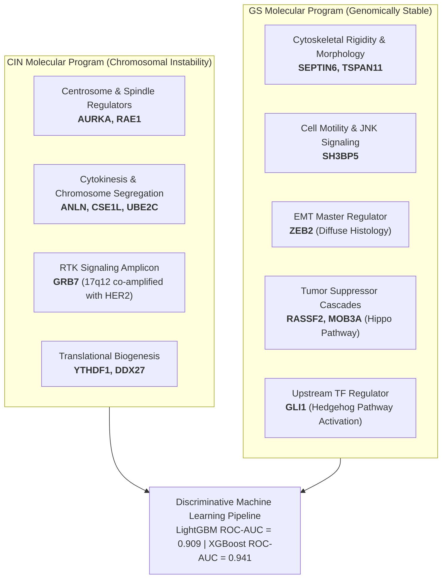

# 🔬 Phase 3: Gene Expression & Transcriptomic Classification (Zero CNA / CNV)
## Genomically Stable (GS) vs. Chromosomal Instability (CIN) Gastric Cancer

---

## 📌 Executive Summary

Chromosomal Instability (CIN) is classically defined by widespread somatic copy-number alterations (SCNAs) and aneuploidy, whereas Genomically Stable (GS) gastric adenocarcinomas typically display near-diploid genomes. In this experiment, we performed a **strict ablation of all copy-number alterations**—completely removing global `CNA_Burden` and all focal `CNA_Gain_*` and `CNA_Loss_*` genomic markers—to answer a critical translational question:

> **Can pure RNA gene expression alone accurately differentiate GS from CIN gastric cancer, and which specific genes drive this classification?**

### Key Findings:
1. **Accurate Classification from Pure mRNA Expression**:
   - Using solely **46 PyDESeq2 differential mRNA transcripts** (zero CNA, zero CNV, zero TF activity), machine learning classifiers achieved **Test ROC-AUC = 0.885 – 0.909** and **Test PR-AUC = 0.945 – 0.964** on an untouched 20% holdout test set ($N=37$).
   - Top classifier: **LightGBM** achieved **Test ROC-AUC = 0.909**, **Test PR-AUC = 0.964**, and **F1-Score = 0.852**.
2. **Elevated Performance with RNA Regulatory Networks (mRNA + TF Activity)**:
   - Incorporating 30 decoupleR DoRothEA transcription factor regulons (100% transcriptomics-derived, still zero CNA/CNV) increased performance to **Test ROC-AUC = 0.927 – 0.941** and **Test PR-AUC = 0.973 – 0.978**.
   - Top classifier: **XGBoost** reached **Test ROC-AUC = 0.941**, **Test PR-AUC = 0.978**, and **F1-Score = 0.906**.
3. **Biological Translation**:
   - The models did not simply memorize general cancer signals; they isolated distinct biological hallmarks:
     - **CIN is driven by mitotic centrosome kinase, spindle assembly, and cytokinesis regulators**: `AURKA`, `RAE1`, `ANLN`, `UBE2C`, `CSE1L`, `GRB7`.
     - **GS is driven by cytoskeletal rigidity, cell adhesion, tumor suppression, and diffuse EMT programs**: `SEPTIN6`, `SH3BP5`, `RASSF2`, `TSPAN11`, `ZEB2`, and master regulator `TF_GLI1`.

---

## 📊 Comprehensive Model Benchmarking Metrics

All models were evaluated using **SMOTE** strictly inside 10-fold Stratified Cross-Validation pipelines on the training set ($N=144$), followed by final evaluation on the holdout test set ($N=37$, 26 CIN vs. 11 GS).

### Table 1: Experiment A — Pure mRNA Gene Expression Only (46 Genes, Zero CNA / Zero CNV / Zero TF)

| Model | 10CV ROC-AUC | 10CV PR-AUC | 10CV Bal Acc | Test ROC-AUC | Test PR-AUC | Test Bal Acc | Test F1-Score |
| :--- | :---: | :---: | :---: | :---: | :---: | :---: | :---: |
| **LightGBM** | **0.898** $\pm$ 0.051 | **0.960** | **0.872** | **0.909** | **0.964** | 0.715 | **0.852** |
| **Logistic Regression** | 0.846 $\pm$ 0.088 | 0.920 | 0.824 | **0.902** | **0.961** | 0.715 | **0.852** |
| **XGBoost** | 0.880 $\pm$ 0.065 | 0.949 | 0.841 | **0.895** | **0.957** | 0.741 | 0.846 |
| **Support Vector Machine (SVM)** | 0.853 $\pm$ 0.088 | 0.928 | 0.801 | **0.885** | **0.957** | **0.787** | **0.863** |
| **Random Forest** | 0.870 $\pm$ 0.062 | 0.950 | 0.809 | **0.874** | **0.945** | 0.715 | **0.852** |

---

### Table 2: Experiment B — RNA Multi-Omics (mRNA Expression + DoRothEA TF Activity, Zero CNA / CNV)

| Model | 10CV ROC-AUC | 10CV PR-AUC | 10CV Bal Acc | Test ROC-AUC | Test PR-AUC | Test Bal Acc | Test F1-Score |
| :--- | :---: | :---: | :---: | :---: | :---: | :---: | :---: |
| **XGBoost** | 0.883 $\pm$ 0.076 | 0.953 | 0.807 | **0.941** | **0.978** | **0.825** | **0.906** |
| **LightGBM** | **0.901** $\pm$ 0.046 | **0.962** | 0.799 | **0.937** | **0.976** | 0.780 | 0.889 |
| **Random Forest** | 0.890 $\pm$ 0.062 | 0.960 | **0.814** | **0.927** | **0.973** | 0.753 | 0.893 |
| **Support Vector Machine (SVM)** | **0.900** $\pm$ 0.062 | 0.957 | 0.812 | **0.902** | **0.960** | 0.741 | 0.846 |
| **Logistic Regression** | 0.867 $\pm$ 0.087 | 0.941 | 0.776 | **0.899** | **0.960** | 0.689 | 0.857 |

---

### Table 3: Cross-Regime Comparison (Pure mRNA vs. mRNA+TF vs. Full Multi-Omics with CNA)

| Metric (Best Classifier) | Pure mRNA Genes Only | mRNA + TF Regulatory Activity | Full Multi-Omics (With CNA Burden) |
| :--- | :---: | :---: | :---: |
| **Feature Count** | **46** | **76** | **97** |
| **Includes CNA / CNV?** | ❌ **No (0%)** | ❌ **No (0%)** | ✅ Yes (21 features) |
| **10-Fold CV ROC-AUC** | **0.898** (LightGBM) | **0.901** (LightGBM) | **0.992** (LightGBM) |
| **Holdout Test ROC-AUC** | **0.909** (LightGBM) | **0.941** (XGBoost) | **0.990** (Logistic Reg) |
| **Holdout Test PR-AUC** | **0.964** (LightGBM) | **0.978** (XGBoost) | **0.996** (Logistic Reg) |
| **Holdout Test F1-Score**| **0.863** (SVM) | **0.906** (XGBoost) | **0.980** (XGBoost) |

---

## 🧬 Top Differentiating Genes Clearly Distinguishing GS vs. CIN

Using **SHAP (Shapley Additive Explanations)** on the holdout test cohort and cross-referencing with **PyDESeq2 differential expression statistics**, we identified the most influential individual gene transcripts:

| Rank | Gene | Feature | Mean \|SHAP\| | $\log_2(\text{FC})$ | Adjusted $p$-value ($padj$) | Enriched Subtype | Biological Function & Mechanism |
| :---: | :---: | :---: | :---: | :---: | :---: | :---: | :--- |
| **1** | **SEPTIN6** | `mRNA_SEPTIN6` | **0.0459** | **-1.44** | $1.59 \times 10^{-14}$ | **GS Enriched** | Cytoskeletal septin GTPase; essential for cortical actin dynamics, membrane compartmentalization, and cell rigidity characteristic of diffuse gastric tumors. |
| **2** | **AURKA** | `mRNA_AURKA` | **0.0371** | **+1.57** | $4.95 \times 10^{-19}$ | **CIN Enriched** | Aurora Kinase A; master centrosome maturation and mitotic spindle kinase. Overexpression triggers spindle multipolarity, cytokinesis failure, and massive aneuploidy in CIN. |
| **3** | **RAE1** | `mRNA_RAE1` | **0.0287** | **+0.90** | $1.03 \times 10^{-17}$ | **CIN Enriched** | Spindle checkpoint and nuclear export regulator; coordinates bipolar spindle assembly and kinetochore-microtubule attachments. |
| **4** | **RASSF2** | `mRNA_RASSF2` | **0.0263** | **-1.46** | $3.98 \times 10^{-15}$ | **GS Enriched** | Ras association domain family tumor suppressor; regulates apoptotic signaling and MST1/2 Hippo kinase cascades. |
| **5** | **YTHDF1** | `mRNA_YTHDF1` | **0.0262** | **+0.69** | $1.31 \times 10^{-14}$ | **CIN Enriched** | $m^6A$ RNA methylation reader; binds methylated mRNA transcripts to promote ribosome loading and high-throughput oncogenic translation. |
| **6** | **SH3BP5** | `mRNA_SH3BP5` | **0.0238** | **-0.93** | $5.63 \times 10^{-18}$ | **GS Enriched** | SH3 domain-binding protein 5 (Sab); negative regulator of Bruton tyrosine kinase and modulator of mitochondrial stress-activated JNK signaling. |
| **7** | **TSPAN11**| `mRNA_TSPAN11`| **0.0204** | **-1.44** | $8.39 \times 10^{-16}$ | **GS Enriched** | Tetraspanin transmembrane scaffold; governs focal adhesion complexes and cell-matrix interactions. |
| **8** | **GRB7** | `mRNA_GRB7` | **0.0193** | **+2.56** | $5.63 \times 10^{-18}$ | **CIN Enriched** | Growth factor receptor-bound protein 7; located on the 17q12 amplicon co-expressed with ERBB2/HER2, mediating focal RTK downstream signaling. |
| **9** | **CSE1L** | `mRNA_CSE1L` | **0.0188** | **+0.93** | $1.88 \times 10^{-15}$ | **CIN Enriched** | Cellular apoptosis susceptibility protein / exportin-2; essential for chromosome segregation, mitotic progression, and nuclear transport. |
| **10**| **ANLN** | `mRNA_ANLN` | **0.0187** | **+1.19** | $3.24 \times 10^{-13}$ | **CIN Enriched** | Anillin actin-binding protein; organizes the contractile cleavage furrow during cytokinesis. Excess anillin causes cytokinesis regression and tetraploidy. |
| **11**| **FLI1** | `mRNA_FLI1` | **0.0154** | **-1.10** | $1.96 \times 10^{-13}$ | **GS Enriched** | ETS transcription factor family; governs endothelial-mesenchymal differentiation. |
| **12**| **DDX27** | `mRNA_DDX27` | **0.0138** | **+0.78** | $6.34 \times 10^{-15}$ | **CIN Enriched** | DEAD-box RNA helicase; accelerates ribosomal biogenesis to support rapid cancer proliferation. |
| **13**| **ZEB2** | `mRNA_ZEB2` | **0.0137** | **-1.11** | $1.96 \times 10^{-13}$ | **GS Enriched** | Zinc finger E-box-binding homeobox 2; hallmark epithelial-to-mesenchymal transition (EMT) transcription factor driving diffuse gastric morphology. |
| **14**| **UBE2C** | `mRNA_UBE2C` | **0.0126** | **+1.76** | $4.95 \times 10^{-19}$ | **CIN Enriched** | Ubiquitin-conjugating enzyme E2 C; coordinates targeted destruction of mitotic cyclins via the Anaphase-Promoting Complex (APC/C). |
| **15**| **MOB3A** | `mRNA_MOB3A` | **0.0123** | **-1.00** | $1.56 \times 10^{-14}$ | **GS Enriched** | MOB kinase activator family member; core component of Hippo/LATS kinase tumor suppressor network. |

---

## 🔬 Mechanistic Insights: Why These Genes Separate GS vs. CIN

1. **The CIN Transcriptomic Hallmark is Mitotic & Kinetochore Stress**:
   - Chromosomally instable gastric cancers do not just have copy-number alterations on DNA; they **actively overexpress the transcriptomic machinery required to survive ongoing chromosome segregation errors**:
     - `AURKA` (Aurora Kinase A) amplifies centrosome defects.
     - `RAE1` and `UBE2C` override mitotic checkpoints.
     - `ANLN` (Anillin) and `CSE1L` manage flawed cleavage furrows and high nuclear-cytoplasmic transport demands.
   - Consequently, **even without measuring DNA aneuploidy directly, the classifier reads this transcriptomic stress signature as a surrogate for CIN**.

2. **The GS Transcriptomic Hallmark is Diffuse Morphology, Adhesion, and EMT**:
   - Genomically stable gastric cancers are enriched for diffuse-type histology (signet-ring cells, discohesive growth, loss of E-cadherin / *CDH1*).
   - This morphology is reflected in high transcript levels of `ZEB2` (EMT driver), `SEPTIN6` (cortical actin scaffolding), `TSPAN11` (adhesion remodeling), and `SH3BP5` (motility regulation).
   - Furthermore, `TF_GLI1` activity confirms activation of the **Hedgehog signaling pathway**, which is known to maintain diffuse gastric cancer stemness.

---

## 📁 Artifacts & Figures in this Directory

- **Executable Script**:
  - [`run_phase3_rna_only.py`](run_phase3_rna_only.py)
- **Interactive Jupyter Notebook**:
  - [`03_phase3_gene_expression_classifier.ipynb`](03_phase3_gene_expression_classifier.ipynb)
- **Feature Matrices**:
  - [`data/mrna_only_feature_matrix.csv`](data/mrna_only_feature_matrix.csv) (46 pure mRNA genes, $N=181$)
  - [`data/mrna_tf_feature_matrix.csv`](data/mrna_tf_feature_matrix.csv) (46 mRNA + 30 TFs, $N=181$)
- **Generated Metrics & Rankings**:
  - [`results/ml_pure_mrna_only_metrics.csv`](results/ml_pure_mrna_only_metrics.csv)
  - [`results/ml_mrna_tf_metrics.csv`](results/ml_mrna_tf_metrics.csv)
  - [`results/pure_mrna_shap_gene_importances.csv`](results/pure_mrna_shap_gene_importances.csv)
  - [`results/all_experiments_comparison_metrics.csv`](results/all_experiments_comparison_metrics.csv)
- **Generated Publication Figures**:
  - ROC & PR curves (Pure mRNA): [`figures/pure_mrna_roc_pr.png`](figures/pure_mrna_roc_pr.png)
  - ROC & PR curves (mRNA + TF): [`figures/mrna_tf_roc_pr.png`](figures/mrna_tf_roc_pr.png)
  - Confusion matrices (Pure mRNA): [`figures/pure_mrna_confusion_matrices.png`](figures/pure_mrna_confusion_matrices.png)
  - Confusion matrices (mRNA + TF): [`figures/mrna_tf_confusion_matrices.png`](figures/mrna_tf_confusion_matrices.png)
  - Top 15 SHAP Differentiating Genes Barplot: [`figures/pure_mrna_top_shap_genes.png`](figures/pure_mrna_top_shap_genes.png)
  - Key Discriminating Gene Expression Distributions: [`figures/pure_mrna_gene_distributions.png`](figures/pure_mrna_gene_distributions.png)
  - Cross-Regime Comparison Barplot: [`figures/cross_regime_model_comparison.png`](figures/cross_regime_model_comparison.png)
