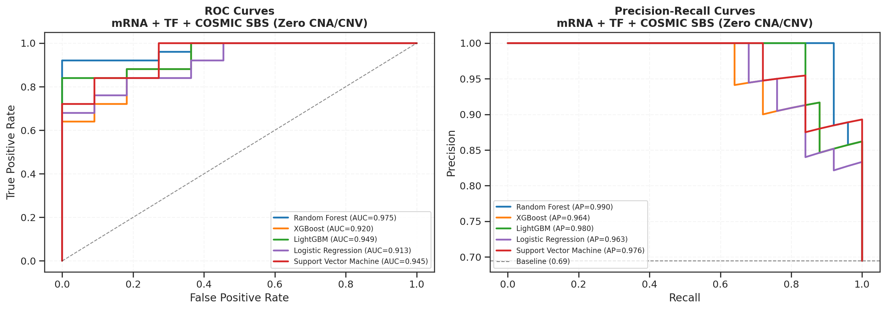

# Bengaluru Tech Summit 2026
**November 17-19, 2026, Bangalore International Exhibition Center**

---

### Machine Learning-Driven Multi-Omics Classification of Genomically Stable and Chromosomal Instability Gastric Adenocarcinoma Without Copy-Number Profiling

**Author One¹\*, Author Two², Author Three¹**  
¹ Department of Biotechnology / Computational Biology, Institution / University Name, City, State, India  
² Department of Bioinformatics / Oncology, Partner Institution / Hospital Name, City, State, India  
*E-mail addresses: author1@institution.edu, author2@institution.edu, author3@institution.edu*  

---

#### 1. Introduction:
Gastric adenocarcinoma (STAD) displays marked molecular and clinical heterogeneity. In the non-hypermutated disease spectrum, tumors are categorized into Genomically Stable (GS) and Chromosomal Instability (CIN) subtypes [1]. Clinically, GS tumors are associated with substantially poorer overall survival and marked resistance to adjuvant chemotherapy compared to CIN [2]. Furthermore, GS tumors are strongly enriched for diffuse-type histology under the Laurén classification [3], whereas CIN tumors are predominantly intestinal. Although CIN is defined by somatic aneuploidy, standard copy-number assays require high amounts of intact DNA, incurring prohibitive costs and high failure rates in degraded formalin-fixed paraffin-embedded (FFPE) biopsies. To overcome this translational bottleneck, we developed a non-invasive multi-omics machine learning framework that stratifies GS and CIN using mRNA expression, transcription factor (TF) activity, and somatic mutational signatures without requiring copy-number data.

#### 2. Material and Methods:
Clinical and molecular profiles of 205 curated TCGA-STAD patients (147 CIN, 58 GS; excluding EBV and MSI) were investigated. Phase 1 comprised clinicopathological characterization and age-stratified Kaplan-Meier overall survival (OS) estimation. Phase 2 extracted multi-modal molecular features: (i) 46 differentially expressed genes via PyDESeq2 negative binomial Wald testing, (ii) 30 TF regulon activities inferred using decoupleR and DoRothEA univariate linear models, and (iii) 5 COSMIC Single Base Substitution (SBS) mutational signatures deconvolved via non-negative matrix factorization. In the predictive modeling phase, 81 integrated features across 177 patients were evaluated across five algorithms (Random Forest, SVM, LightGBM, XGBoost, Logistic Regression) using SMOTE-balanced 10-fold cross-validation on 80% training data and evaluated on an independent holdout test cohort (N = 36; 25 CIN, 11 GS).

#### 3. Significant Results and Discussion
In Phase 1, GS patients presented at a significantly younger age (median 59.4 vs. 68.4 years, *p* < 0.0001) and exhibited diffuse histology enrichment (69.0% vs. 12.2%, *p* < 0.0001). Age-stratified survival analysis (age ≤ 70 years) revealed severe 5-year OS deficits in GS relative to CIN (23.1% vs. 68.1%, log-rank *p* = 0.021). In Phase 2, CIN tumors displayed pronounced upregulation of mitotic spindle regulators (*UBE2C*, *AURKA*), elevated E2F transcription factor activity (*E2F2*, *E2F3*, *TFDP1*), and significant enrichment in APOBEC cytidine deaminase mutagenesis (SBS2/13 mean exposure: 0.221 CIN vs. 0.104 GS, *p* = 1.37 × 10⁻⁷). Conversely, GS tumors showed elevated *GLI1* activity and diffuse-associated cytoskeleton expression (*SEPTIN6*, *SH3BP5*).

##### Table 1: Performance of copy-number-free machine learning classifiers (81 features)
| Classifier | 10-Fold CV AUC | Test ROC-AUC | Test PR-AUC | Balanced Acc. | Test F1-Score |
| :--- | :---: | :---: | :---: | :---: | :---: |
| **Random Forest** | 0.891 | **0.975** | **0.990** | 0.798 | **0.906** |
| **SVM** | 0.890 | 0.945 | 0.976 | **0.844** | **0.923** |
| LightGBM | 0.876 | 0.949 | 0.980 | 0.758 | 0.863 |
| XGBoost | 0.865 | 0.920 | 0.964 | 0.804 | 0.880 |
| Logistic Reg. | 0.847 | 0.913 | 0.963 | 0.778 | 0.885 |

*Figure 1: Receiver operating characteristic (ROC) and Precision-Recall (PR) curves on holdout test cohort (N = 36)*

In predictive modeling (Table 1, Figure 1), the copy-number-free classifier achieved outstanding diagnostic accuracy. Random Forest achieved holdout Test ROC-AUC of 0.975, PR-AUC of 0.990, and F1-score of 0.906, correctly identifying 24 of 25 CIN patients (96% sensitivity). SVM demonstrated balanced accuracy of 0.844 and F1-score of 0.923. Crucially, integrating mutational signatures with mRNA and TF regulons boosted holdout ROC-AUC from 0.941 to 0.975, demonstrating that orthogonal mutational and transcriptomic signatures effectively surrogate for DNA copy-number alterations.

#### 4. Conclusions:
This study demonstrates that an 81-feature multi-omics classifier integrating mRNA transcripts, TF regulons, and COSMIC mutational signatures achieves near-ceiling diagnostic accuracy (ROC-AUC = 0.975, PR-AUC = 0.990) in distinguishing GS from CIN gastric adenocarcinoma. By eliminating the necessity for costly DNA copy-number assays, this pipeline offers a highly robust, cost-effective, and clinically viable tool for patient stratification and therapy selection.

#### References
[1] The Cancer Genome Atlas Research Network, Nature, 513 (7517) 2014, 202-209.  
[2] B. H. Sohn, J. E. Hwang, H. J. Jang, et al., Clin. Cancer Res., 23 (15) 2017, 4441-4449.  
[3] P. Laurén, Acta Pathol. Microbiol. Scand., 64 (1) 1965, 31-49.  
